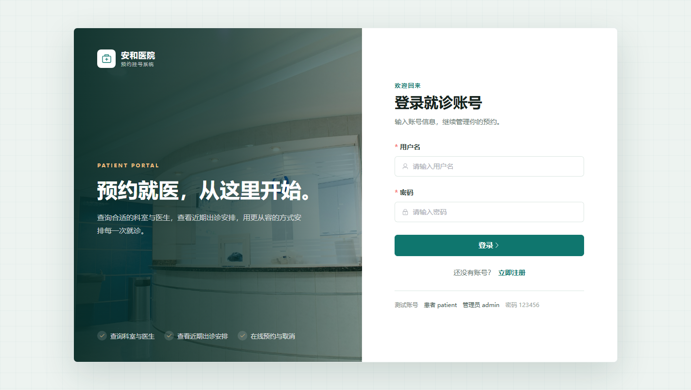
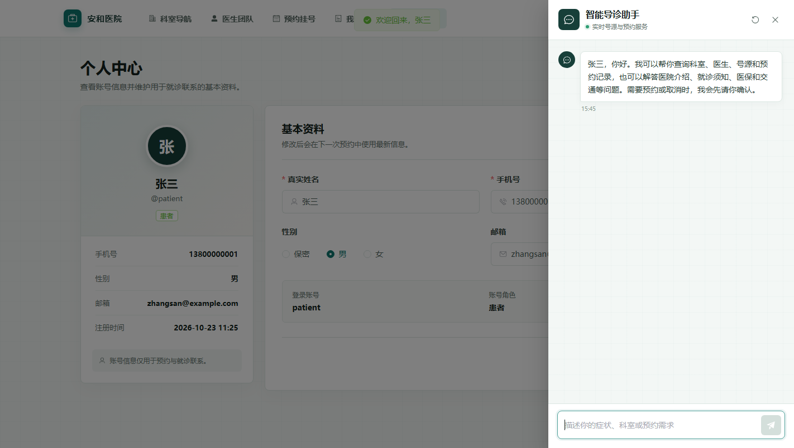
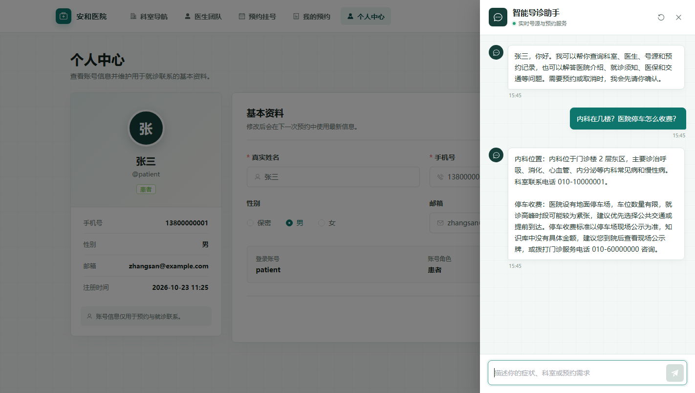
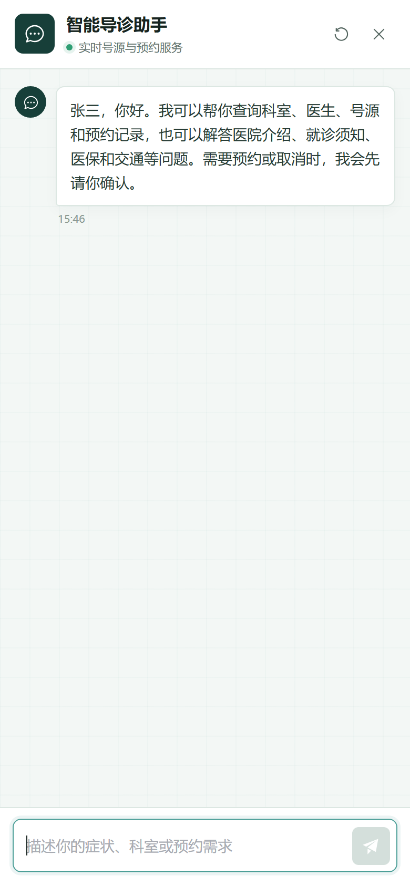
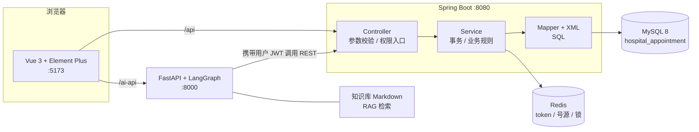

# 医院预约挂号系统

<p>
  
  
  
  
  
  
  
  
  
</p>

前后端分离的医院预约挂号系统：患者可查询科室、医生与排班并完成预约/取消，管理员可维护科室、医生、排班、预约与用户；患者端内置基于 LangGraph 的 **AI 智能导诊助手**，可查询真实号源并生成预约确认单。

**技术关键词**：Spring Boot 4 · MyBatis · MySQL 条件更新 · Redis Lua 原子扣减 · 分布式锁 · JWT · Vue 3 + Element Plus · FastAPI + LangGraph Tool Calling · RAG

## 界面预览

| 登录页 | 个人中心 + AI 助手 |
|---|---|
|  |  |

| AI 导诊问答（真实号源 + 知识库） | 移动端适配 |
|---|---|
|  |  |

## 项目亮点

- **号源不超卖**：Redis Lua 脚本原子预扣 → MySQL `UPDATE ... WHERE available > 0` 条件更新二次兜底，双保险。实测 8 个并发用户抢 3 个号源，只成功 3 单。
- **完整降级链路**：Redis 不可用时自动退回「JWT + MySQL」流程，登录、预约、取消照常工作，只输出告警日志；恢复后无需重启。
- **分布式锁防重**：同一排班的预约使用 Redis `SET NX PX` 加锁，释放时用 Lua 校验持有者 token，避免误删他人锁。
- **AI 不能越权**：AI 服务不信任模型给出的用户 ID，一切身份以 Java 端校验 JWT 后注入的上下文为准；模型只能调用受控 Tool。
- **写操作先确认**：预约/取消由 Agent 生成确认单，用户核对后再执行，避免自然语言误触发业务变更。
- **RAG 零依赖**：医院介绍、就诊须知、医保报销、交通停车等 Markdown 知识库，内置关键词检索，无需额外 Embedding 服务。
- **统一响应与异常**：所有接口返回 `{ code, message, data }`，异常由全局处理器统一转换；参数校验、权限校验集中在入口。

## 技术栈

| 层级 | 技术 | 版本 |
|---|---|---|
| 后端 | Java | 17 |
| 后端 | Spring Boot | 4.1.2 |
| 后端 | MyBatis Spring Boot Starter | 4.1.0 |
| 后端 | JJWT | 0.13.0 |
| 数据库 | MySQL | 8.0+ |
| 缓存 | Redis（Windows 本地为 Memurai 4.1.2） | 7.2 兼容 |
| 前端 | Vue / Vite / Element Plus / Axios | 3.5.44 / 7.3.7 / 2.14.7 / 1.20.0 |
| AI 服务 | Python / FastAPI / LangGraph / LangChain OpenAI | 3.9+ / 0.128.8 / 0.6.11 / 0.3.35 |
| 构建 | Maven Wrapper（仅脚本模式，无需预装 Maven） | 3.10.0 |

## 系统架构



一次请求的调用链：`Vue → Axios → Controller（边界）→ Service（业务/事务）→ Mapper（SQL）→ MySQL → VO/Result → 前端`。

## 快速开始

### 1. 环境准备

JDK 17、Node.js 20.19+ / 22+、MySQL 8.0、Redis 7.2（可选，缺失时自动降级）。Maven 由项目自带 Wrapper 提供。

### 2. 初始化数据库

```bash
mysql -uroot -p --default-character-set=utf8mb4 -e "source sql/00-create-database.sql"
mysql -uroot -p --default-character-set=utf8mb4 -e "source sql/01-schema.sql"
mysql -uroot -p --default-character-set=utf8mb4 -e "source sql/02-data.sql"
mysql -uroot -p --default-character-set=utf8mb4 -e "source sql/03-verify.sql"
```

> `01-schema.sql` 会**删除并重建**业务表，仅用于首次初始化或开发环境重置。`03-verify.sql` 用于校验号源一致性，正常返回 0 行。

### 3. 配置本地私有变量

```bash
cp .env.example .env
```

编辑 `.env`，至少填写数据库密码：

```dotenv
DB_PASSWORD=你的数据库密码
JWT_SECRET=至少 32 位的随机字符串
```

`.env` 已被 `.gitignore` 忽略。也可以改用同名系统环境变量（优先级更高）。

### 4. 启动 Redis（推荐）

```bash
# Windows 使用项目自带脚本（需本机安装 Memurai）
powershell -ExecutionPolicy Bypass -File scripts/redis/start-redis.ps1
```

### 5. 启动后端

```bash
./mvnw spring-boot:run        # Linux / macOS
mvnw.cmd spring-boot:run      # Windows
```

后端：<http://localhost:8080>

### 6. 启动前端

```bash
cd frontend
npm install
npm run dev
```

前端：<http://localhost:5173>，Vite 已将 `/api` 代理到 `8080`、`/ai-api` 代理到 `8000`。

### 7. 启动 AI 服务（可选）

```bash
cd ai-service
python -m venv .venv && ./.venv/Scripts/activate     # Windows
pip install -r requirements.txt
cp .env.example .env                                  # 填写 LLM_BASE_URL / LLM_API_KEY / LLM_MODEL
python -m uvicorn app.main:app --host 127.0.0.1 --port 8000
```

健康检查：<http://127.0.0.1:8000/ai-api/health>。未配置 Key 时，AI 助手返回明确提示，其余功能不受影响。

### IDEA 一键启动

`.run/` 下已预置共享运行配置：`后端服务`（Maven `spring-boot:run`）、`前端服务`（npm `dev`）、`一键启动`（Compound，同时拉起前后端）。用 IDEA 打开**项目根目录**即可在右上角直接运行。

## 测试账号

| 角色 | 用户名 | 密码 | 入口 |
|---|---|---|---|
| 管理员 | `admin` | `123456` | `/admin` 管理后台 |
| 患者 | `patient` | `123456` | 个人中心 |
| 患者 | `patient2` | `123456` | 个人中心 |

## 目录结构

```text
.
├─ src/main/java/com/example/hospital
│  ├─ common        # 统一返回、全局异常、JWT、登录上下文
│  ├─ config        # Web、拦截器、安全、Redis 配置
│  ├─ controller    # 患者端与管理端 REST API
│  ├─ dto / entity / vo
│  ├─ mapper        # MyBatis Mapper 接口
│  └─ service
│     └─ cache      # Redis token、号源缓存、分布式锁
├─ src/main/resources
│  ├─ mapper        # MyBatis XML
│  └─ application.yml
├─ frontend         # Vue 3 前端（views / api / router / stores / layouts）
├─ ai-service       # FastAPI + LangGraph（agent / clients / rag / services / knowledge）
├─ sql              # 建库、建表、初始化数据、一致性校验
├─ docs             # 数据库设计、验收与回归报告、界面截图
├─ scripts/redis    # 本地 Redis 启停脚本
└─ .run             # IDEA 共享运行配置
```

## 核心业务规则与实现

| 场景 | 实现方式 |
|---|---|
| 扣减号源 | Redis Lua 原子预扣 → MySQL `available_slots > 0` 条件更新，任一步失败即回滚 |
| 重复预约 | 唯一约束 + Service 层幂等校验，同一用户同一排班只能存在一条有效预约 |
| 取消预约 | 校验归属、状态与「就诊开始前 2 小时」规则，同一事务内回补号源 |
| 并发安全 | Redis `SET NX PX` 分布式锁按排班粒度串行化，Lua 校验 token 后释放 |
| 缓存一致性 | 排班增删改/停诊后清理号源缓存；取消预约后按 MySQL 最新值回写 |
| 身份认证 | JWT（jjwt）+ 拦截器；token 写入 Redis 支持注销与禁用即时失效 |
| 数据安全 | 密码 BCrypt 哈希存储，接口不返回敏感字段；管理员不能禁用自己或最后一个管理员 |
| 数据保留 | 科室/医生/排班采用状态停用，不物理删除历史业务数据 |

## 接口概览

| 模块 | 路径前缀 | 说明 |
|---|---|---|
| 认证 | `/api/auth` | 注册、登录、注销、当前用户 |
| 公开查询 | `/api/public/{departments,doctors,schedules}` | 科室导航、医生团队、号源筛选（免登录） |
| 患者 | `/api/appointments`、`/api/user` | 预约、取消、我的预约、资料维护 |
| 管理 | `/api/admin/**` | 概览统计、科室、医生、排班、预约、用户管理 |
| AI | `/ai-api/**` | 对话、确认单、健康检查 |

## 测试与质量

| 类型 | 命令 | 说明 |
|---|---|---|
| 后端集成测试 | `mvnw.cmd "-Dredis.integration=true" "-Dappointment.integration=true" "-Dtest=RedisEnvironmentIntegrationTest,AppointmentBookingIntegrationTest" test` | 需 MySQL + Redis；8 并发抢 3 号源仅 3 单成功，取消后回补 1 |
| AI 服务单测 | `cd ai-service && pytest -q` | 54 个用例覆盖 Agent 图、工具调用、确认单、会话存储 |
| 前端构建 | `cd frontend && npm run build` | Vite 生产构建 |
| 数据库校验 | `mysql -uroot -p -e "source sql/03-verify.sql"` | 号源一致性检查应返回 0 行 |
| 持续集成 | GitHub Actions | 每次推送自动编译后端、构建前端 |

回归与验收记录见 [`docs/regression-test-report.md`](docs/regression-test-report.md)、[`docs/ai-acceptance-report.md`](docs/ai-acceptance-report.md)，数据库设计见 [`docs/database-design.md`](docs/database-design.md)。

## 常见问题

**后端启动报 `Access denied for user 'root'`？** 检查 `.env` 里的 `DB_PASSWORD` 是否与本机 MySQL 一致，或直接设置同名环境变量。

**Redis 没启动能跑吗？** 能。token 缓存、号源预扣会自动降级为 JWT + MySQL 流程，日志中会出现 `Redis token cache is unavailable` 告警。

**AI 助手一直提示未配置？** `ai-service/.env` 需要填写 `LLM_BASE_URL`、`LLM_API_KEY`、`LLM_MODEL`，并确保 Java 后端已启动（AI 服务通过 HTTP 调用它）。

**端口冲突？** 后端 8080、前端 5173、AI 服务 8000，可在 `application.yml`、`vite.config.js`、`.env` 中调整。

## 许可证

[MIT](LICENSE)
