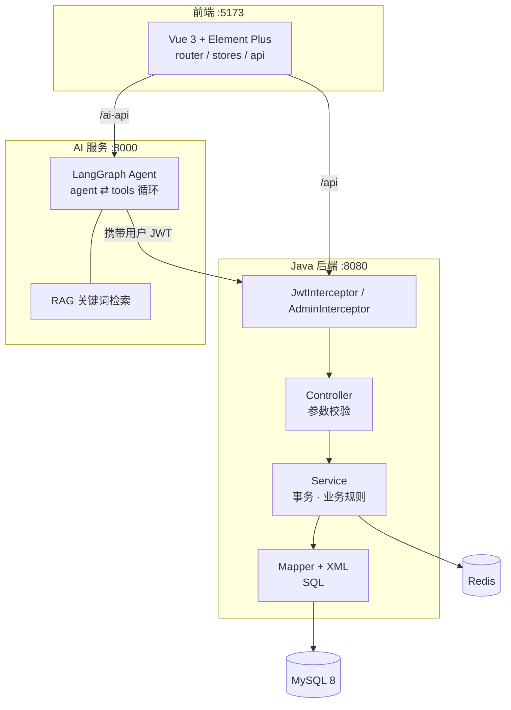

# 技术设计说明

> 面向面试的技术视角：这个系统**为什么**这样设计、关键取舍在哪、被追问时怎么答。
> 偏实现细节的接口清单见 [README](../README.md)，表结构细节见 [数据库设计](database-design.md)。

## 1. 项目定位与范围

一个单院区的医院预约挂号系统，核心是**号源（可预约名额）在并发下不能超卖**，以及**把大模型安全地接进业务**。

| 角色 | 核心用例 |
|---|---|
| 游客 | 浏览科室、医生、排班号源 |
| 患者 | 注册登录、查号源、预约、查看/取消预约、维护资料、向 AI 助手提问 |
| 管理员 | 概览统计、科室/医生/排班维护、预约查询与状态处理、用户启停 |

**明确的非目标**（保持项目边界清晰，避免"什么都做"）：
- 不做在线支付、短信通知、多院区/多租户；
- AI 只做**导诊与代下单入口**，不做诊断建议；
- 不做分布式事务框架，跨服务一致性靠"单一写入口 + 业务补偿"。

## 2. 总体架构



三层职责刻意切得很干净：**Controller 只做边界**（收参、校验、拿登录态），**Service 承载业务与事务**，**Mapper 只写 SQL**。好处是业务规则不会被前端或 Controller 绕过，测试也能直接打 Service。

### 为什么把 AI 拆成独立进程

| 理由 | 说明 |
|---|---|
| 生态 | LangGraph / LangChain 在 Python 侧成熟，Java 侧可用但要重写编排 |
| 故障隔离 | 模型超时、限流、Key 失效只影响 `/ai-api`，不拖垮挂号主链路 |
| 扩缩容 | Agent 是无状态计算，可独立横向扩容；Java 侧跟着 DB 连接池走 |
| 安全边界 | AI 服务**不持有数据库连接**，只能通过 HTTP + 用户 JWT 调用后端，越权面可控 |

代价是多一个进程与一次网络跳转；对本项目是划得来的，因为"AI 挂了大不了不用 AI"。

## 3. 数据模型要点

五张表：`sys_user`、`department`、`doctor`、`schedule`、`appointment`。

几个刻意的设计决定：

1. **`schedule` 冗余 `total_slots` 与 `available_slots`**
   号源是"每天每医生每时段"一行，把"总数"和"剩余"拆开，才能写出
   `UPDATE ... SET available_slots = available_slots - 1 WHERE available_slots > 0` 这种**由数据库保证原子性**的语句，不需要先查后改。

2. **`uk_doctor_date_period (doctor_id, work_date, period)`**
   从数据层杜绝"同一医生同一天同一时段被排两次班"，业务层就不用再校验。

3. **`appointment` 冗余医生姓名/科室名/挂号费（下单快照）**
   医生改职称、科室改名、挂号费调整后，历史预约单仍显示当时的信息——这是**有意的反范式**，因为预约单是凭证类数据。

4. **状态位代替物理删除**
   科室/医生/排班用 `status` 停用；预约用 `0 待就诊 / 1 已完成 / 2 已取消 / 3 爽约`。历史业务数据不可删，否则统计和审计都会失真。

5. **唯一约束兜底**
   `uk_username`、`uk_phone`、`uk_appointment_no` 等，让"重复注册""单号撞车"这类问题在数据库层直接失败，而不是靠应用层保证。

## 4. 核心流程：预约下单

### 4.1 执行顺序

```
① 登录态与角色校验（仅患者）
② 获取排班级分布式锁  key=hospital:lock:schedule:{id}  TTL=10s  重试 100×50ms
③ 开启事务
   3.1 SELECT ... FOR UPDATE 读排班（含医生、科室状态）
   3.2 可约校验：排班开放 / 医生在职 / 科室启用 / 有余额 / 未过期
   3.3 重复预约校验：countActiveByUserAndSchedule
   3.4 Redis Lua 原子预扣（-2 缺失 / 0 售罄 / 1 成功）
   3.5 MySQL 条件更新 available_slots - 1（影响行数 0 → 抛出冲突）
   3.6 写入 appointment
④ 事务提交后：用 MySQL 真值回写 Redis 号源缓存
⑤ finally 释放锁（Lua 校验 token 后才删）
```

失败时若已发生 Redis 预扣，回滚路径会重新用数据库真值同步缓存，避免缓存比库少 1。

### 4.2 为什么是"两道防线"

| 方案 | 并发安全 | 性能 | 问题 |
|---|---|---|---|
| 只查再改（select → 判断 → update） | ❌ | 好 | 经典超卖 |
| 只靠 MySQL 条件更新 | ✅ | 单点压力大 | 每次下单都打 DB 行锁 |
| 只靠 Redis 扣减 | ✅ | 最好 | 缓存丢数据/不一致时无法自证 |
| **Redis 预扣 + MySQL 条件更新** | ✅ | 好 | 多一次 Redis 往返 |

采用第四种：Redis 承担"挡掉绝大多数无效请求"的压力，MySQL 的条件更新是**最终真相**。即使 Redis 数据脏了（被清空、被多扣），最坏结果是"少卖"，绝不会"超卖"。

### 4.3 缓冲自愈策略

`ScheduleSlotCacheService` 把 Redis 返回分成四种状态，分别处理：

| Redis 返回 | 含义 | 处理 |
|---|---|---|
| `SUCCESS (1)` | 预扣成功 | 继续走 MySQL 条件更新 |
| `SOLD_OUT (0)` | 缓存认为没号 | 若 DB 仍有余额 → **以 DB 为准**修正缓存后重试一次（缓存可能被误扣） |
| `MISSING (-2)` | key 不存在 | 用 DB 值初始化后重试一次 |
| `UNAVAILABLE` | Redis 不可用 | 直接跳过预扣，走纯 MySQL 流程 |

这是"**数据库为准、缓存可重建**"原则的具体落地。

## 5. 取消预约与号源回补

规则：只能取消本人（管理员例外）的**待就诊**预约；患者需在**就诊开始前 2 小时**外取消。

事务内顺序：`FOR UPDATE` 读排班 → `FOR UPDATE` 读预约 → 归属/状态/时间校验 → 回补号源 → 状态条件更新。

两个细节：
- 回补 SQL 带 `AND available_slots < total_slots`，防止异常情况下把号源加到超过总数；
- 状态更新用 `UPDATE ... WHERE status = 0`，返回 0 行即说明已被其他请求改过，直接报"请刷新后重试"，而不是靠先查后改。

## 6. 并发控制

**锁粒度选在排班（scheduleId），不是用户，也不是全局。**
- 全局锁 → 所有预约串行，吞吐不可接受；
- 用户锁 → 挡不住"两个人抢同一个号"；
- 排班锁 → 同号源串行、不同号源并行，正好匹配业务冲突域。

**锁的 TTL 与重试**：10s TTL、100 次 × 50ms（最多 5s）等待，超时抛"正在处理其他预约，请稍后重试"。TTL 内没有自动续期（已知局限，见第 10 节）。

**释放必须校验持有者**：`if GET(key) == token then DEL(key)`，否则 A 的锁超时后 B 拿到锁，A 执行完把 B 的锁删掉——这是分布式锁最常见的坑。

## 7. 认证与安全

- **JWT（jjwt）+ Redis 白名单**：token 的哈希写入 `hospital:auth:token:{hash}`，用户维度再存一个 set 便于"禁用/改密后踢下线"。拦截器每次校验"签名合法 + Redis 里仍在"，实现**主动失效**（纯 JWT 做不到）。
- **降级**：Redis 不可用时退回"仅校验 JWT 签名 + 查库确认用户状态"。权衡是牺牲了"即时注销"，换取"Redis 挂了也能登录"——对毕设/实习项目，可用性优先。
- **越权防护**：详情、取消都校验 `appointment.userId == 当前用户`（管理员例外）；`/api/admin/**` 由独立拦截器校验角色。
- **密码**：BCrypt 哈希，接口永不返回密码字段。
- **SQL 注入**：全部 `#{}` 预编译，无字符串拼接。
- **配置安全**：数据库密码、JWT 密钥走 `.env`（已 gitignore），仓库里只有 `.env.example`。

## 8. AI 助手设计

### 8.1 编排：LangGraph 状态机

```
agent ──(有 tool_calls)──> tools ──> agent ──(无 tool_calls)──> END
```

只用了标准的 `agent ⇄ tools` 循环，但落到图结构上有两个好处：**可单测**（替换 model 就能测编排逻辑）、**可扩展**（要加"意图分类""转人工"节点不用重写）。

### 8.2 工具即权限边界

| 工具 | 能力 | 是否写数据 |
|---|---|---|
| `list_departments` / `list_doctors` / `list_schedules` | 查科室、医生、真实号源 | 否 |
| `search_hospital_knowledge` | 检索医院知识库 | 否 |
| `list_my_appointments` | 查**本人**预约 | 否 |
| `prepare_appointment` / `prepare_cancellation` | 生成确认单（pending） | 否，仅暂存 |

模型**没有任何直接写库的工具**——它能做的最大动作是"生成一张确认单"。

### 8.3 身份不可伪造

用户身份只在请求入口从 JWT 解出（`AuthenticatedUser`），工具签名里**不暴露 userId 参数**，由服务端注入。因此模型即使被提示词攻击要求"查用户 3 的预约"，也没有参数可填。

### 8.4 写操作二次确认

```
模型 → prepare_appointment → 返回 action_id + 摘要（科室/医生/日期/时段/就诊人/费用）
用户 → 前端弹出确认卡片 → 点击确认 → POST /ai-api/confirm/{action_id}
服务端 → 校验归属 + TTL(5min) + status=pending（claim 幂等）→ 调 Java 接口真正下单
```

要点：确认单存在服务端（不是前端传参），用户不能改 payload；`claim` 语义保证同一张单只执行一次；过期自动清理。

### 8.5 RAG 为什么不用向量库

DeepSeek 官方不提供 Embedding 接口，为几十份 Markdown 引入第三方 embedding 服务（申请 Key、计费、网络依赖）不划算。改为：Markdown 分块（480 字符、重叠 80）+ 关键词检索（Top-K 4）。代码保留 `rag_embedding_*` 配置位，将来接向量检索只换 `store` 实现。

### 8.6 失败不编造

模型未配置、超时、限流分别映射成明确错误信息返回前端；System Prompt 里明确"号源与预约必须来自工具结果，不得编造"。宁可回答"暂时查不到"，也不给假号源。

## 9. 接口与错误处理

- 统一响应：`{ code, message, data }`，`code` 与 HTTP 语义对齐（200/400/401/403/404/409/500）。
- 全局异常处理器把 `BusinessException`、参数校验异常（`MethodArgumentNotValidException`）、兜底异常统一转换，Controller 里不写 try-catch。
- 分页统一 `page/size`，Service 层强制 `1 ≤ size ≤ 100`，避免前端传 `size=99999` 打死数据库。
- 日期范围参数做 `endDate >= startDate` 校验。

## 10. 已知局限与改进方向

主动写出来，是因为"知道自己方案的边界"比"声称完美"更可信。

| 局限 | 影响 | 改进 |
|---|---|---|
| 确认单存在进程内内存 | 多实例部署时确认失效 | 换 Redis Hash + TTL |
| 分布式锁无看门狗续期 | 事务超过 10s 会锁提前释放（仍不会超卖，因为有 MySQL 兜底） | 续期线程或 Redisson |
| 号源缓存 TTL 30min | 极端情况下缓存值短暂偏旧 | 写后 sync 已有，可加 binlog 驱动失效 |
| RAG 关键词检索 | 语义召回弱 | 接 bge/text-embedding + 向量库 |
| 无接口文档 | 联调靠 README | 引入 springdoc-openapi |
| 无异步通知 | 预约成功靠用户自己看 | 加 MQ + 短信/站内信，并做"下单成功但通知失败"的补偿 |

## 11. 面试高频问答

**Q1：既然 MySQL 有条件更新，为什么还要 Redis？**
为了挡流量。条件更新是行锁，10 万请求都打到 DB 行锁上会排队、超时、连接池打满。Redis 先扣一次，命中"售罄"的请求在内存层就被拦掉，DB 只处理真正有效的少量请求。

**Q2：Redis 扣了但 MySQL 失败，会不会少卖？**
会少卖（缓存比库少），不会超卖。失败路径会用 DB 真值回写缓存，所以只在"回写也失败"的极端窗口内短暂偏少，且下一次可约时 `SOLD_OUT 但 DB 有号` 的分支会自愈。

**Q3：锁超时了业务还没跑完怎么办？**
当前实现会提前释放，但因为锁只是"减少冲突"的第一层，**MySQL 条件更新仍保证不超卖**。生产做法是加续期（watchdog）或改用 Redisson 的看门狗机制。

**Q4：为什么不直接给 `available_slots` 加乐观锁版本号？**
条件更新本身就是乐观锁（`WHERE available_slots > 0`），再叠版本号是重复设计，反而增加一次回读。

**Q5：取消为什么限制 2 小时？**
号源的价值随时间递减，临就诊放号对医院无意义。规则放在 Service 且区分管理员，是因为这是业务策略，不属于数据约束。

**Q6：JWT 天生无法主动失效，你怎么处理？**
Redis 存白名单（token 哈希 → 用户），注销/禁用时删 key，拦截器校验签名后还要查白名单。Redis 不可用时降级为"签名 + 查库用户状态"，牺牲即时性换可用性。

**Q7：AI 服务为什么不直接连数据库？**
连了就等于把"模型能写库"变成事实。现在 AI 只能调受控 HTTP 接口、带用户 JWT，越权与误操作面都被 Java 侧的校验挡掉。

**Q8：怎么防止模型乱说号源？**
三层：System Prompt 明确禁止编造；工具返回的结构化数据是唯一数据源；写操作必须经过确认单，用户不点就不执行。

**Q9：并发测试怎么做的？**
集成测试里 8 个线程抢 3 个号源，断言成功 3 单、失败 5 单、`available_slots = 0`；再取消 1 单，断言号源回补为 1。用真实 MySQL + Redis（`-Dredis.integration=true -Dappointment.integration=true` 才启用）。

**Q10：如果让你重做一遍，会改什么？**
先做 API 契约（OpenAPI）再做实现；确认单和会话一开始就放 Redis；把"预约成功"变成事件驱动，通知、统计都订阅事件，而不是在 Service 里同步写。
